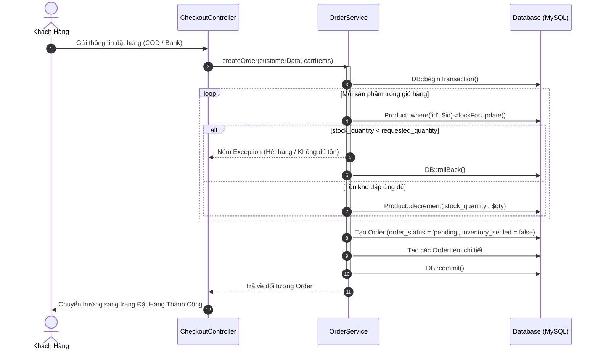

# 04. GIỎ HÀNG, KHUYẾN MÃI & ĐẶT HÀNG (CART, COUPONS & CHECKOUT)

## 1. Cơ Chế Giỏ Hàng (`CartService`)
- **Lưu trữ linh hoạt:** Giỏ hàng hỗ trợ cả khách vãng lai (Session) và khách hàng đã đăng nhập (lưu trong bảng `carts` & `cart_items`). Khi khách hàng đăng nhập, giỏ hàng session được tự động đồng bộ vào database.
- **Bảo vệ chống bán vượt (Overselling Prevention):**
  - Khi thêm vào giỏ (`addToCart`) hoặc cập nhật số lượng (`updateCart`):
    ```php
    $product = Product::active()->findOrFail($productId);
    $availableStock = $product->available_stock;
    if ($requestedQuantity > $availableStock) {
        throw new Exception("Sản phẩm \"{$product->name}\" chỉ còn {$availableStock} sản phẩm trong kho.");
    }
    ```
  - Khách hàng không thể thêm hoặc tăng số lượng vượt quá số hàng đang có trong kho.

---

## 2. Mã Giảm Giá (Coupons)

### Cấu Trúc Bảng `coupons`
- `code` (string, unique): Mã voucher (ví dụ: `GIAM50K`, `TECHSTORE500`).
- `discount_type`:
  - `'fixed'`: Giảm theo số tiền cố định (VNĐ).
  - `'percent'`: Giảm theo phần trăm (0 - 100%).
- `discount_value`: Giá trị giảm.
- `min_order_amount`: Giá trị đơn hàng tối thiểu để áp dụng mã.
- `max_discount_amount`: Số tiền giảm tối đa (đối với giảm theo %).
- `usage_limit` & `used_count`: Giới hạn số lần sử dụng trên toàn hệ thống.
- `starts_at` & `expires_at`: Thời hạn hiệu lực của mã.

### Quy Trình Áp Dụng
- Khách nhập mã tại bước thanh toán (`POST /checkout/coupon`).
- Hệ thống kiểm tra: tính hợp lệ, hạn sử dụng, điều kiện tổng tiền giỏ hàng >= `min_order_amount`.
- Khi đặt hàng thành công: `Coupon::where('id', $order->coupon_id)->increment('used_count')`.
- Nếu đơn hàng bị hủy trước khi giao: `used_count` được hoàn lại (`decrement('used_count')`).

---

## 3. Quy Trình Đặt Hàng & Trừ Kho Tức Thời (Immediate Stock Deduction)

### Luồng Xử Lý Tại `OrderService::createOrder()`


### Điểm Kỹ Thuật Trọng Tâm
1. **Trừ tồn kho ngay khi đặt hàng (`pending`):** Không chờ tới khi Admin bấm duyệt mới trừ kho. Điều này ngăn chặn triệt để tình trạng 2 khách hàng cùng đặt mua món hàng cuối cùng tại cùng một thời điểm.
2. **Khóa bản ghi bằng `lockForUpdate()`:** Đảm bảo tính tuần tự khi có nhiều luồng mua hàng đồng thời (Race Condition).
3. **Cờ `inventory_settled = false`:** Đánh dấu đơn hàng mới phát sinh, tồn kho đã trừ nhưng chưa hoàn tất toàn bộ chu trình xử lý (chưa giao thành công và chưa hủy).

