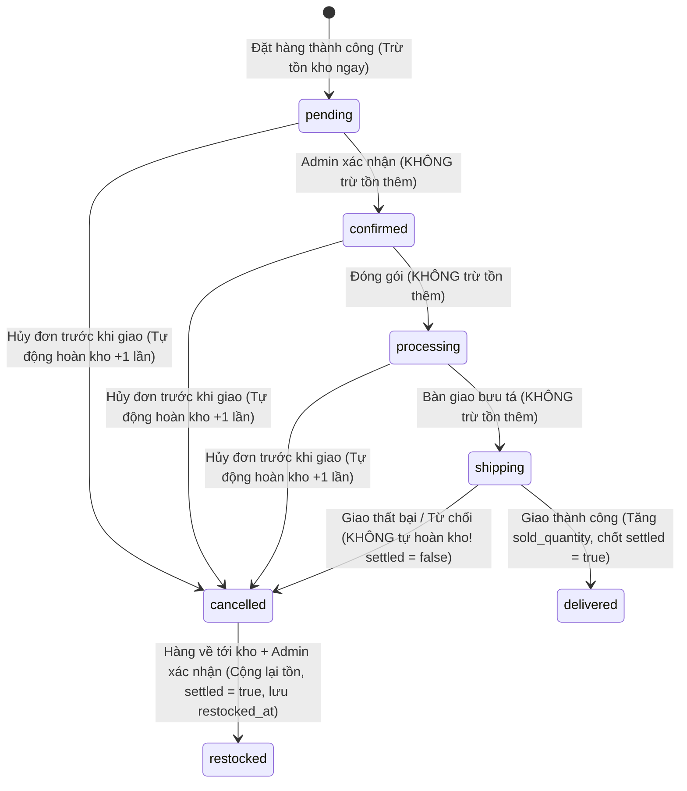

# 05. VÒNG ĐỜI ĐƠN HÀNG, XỬ LÝ HỦY ĐƠN & HOÀN KHO (ORDER LIFECYCLE & RESTOCK)

## 1. Các Trạng Thái Đơn Hàng (Order Status Enum)
Đơn hàng trong TechStore trải qua 6 trạng thái chính:
1. `pending`: Đơn mới tạo, đang chờ xử lý (tồn kho đã được trừ ngay lúc này).
2. `confirmed`: Admin đã xác nhận đơn hàng.
3. `processing`: Đang chuẩn bị hàng, đóng gói.
4. `shipping`: Đã bàn giao cho đơn vị vận chuyển (hàng đang trên đường đi).
5. `delivered`: Giao hàng thành công tới khách hàng (đơn hoàn tất).
6. `cancelled`: Đơn bị hủy (do khách hủy, Admin hủy hoặc giao thất bại).

---

## 2. Quy Tắc Xử Lý Tồn Kho Theo Từng Bước Chuyển Trạng Thái



| Hành Động Chuyển Trạng Thái | Tác Động Lên `stock_quantity` | Tác Động Lên `sold_quantity` | Cập Nhật Cờ `inventory_settled` | Ghi Chú Kỹ Thuật |
|:---|:---:|:---:|:---:|:---|
| **Tạo đơn mới (`pending`)** | **Giảm** theo số lượng mua | Không đổi | `false` | Khóa `lockForUpdate()`, trừ kho tức thời |
| **`pending` -> `confirmed`** | **Giữ nguyên** | Không đổi | Giữ nguyên | Không trừ lặp |
| **`confirmed` -> `processing`** | **Giữ nguyên** | Không đổi | Giữ nguyên | Không trừ lặp |
| **`processing` -> `shipping`** | **Giữ nguyên** | Không đổi | Giữ nguyên | Hàng xuất giao, không trừ lặp |
| **`shipping` -> `delivered`** | **Giữ nguyên** | **Tăng** theo số lượng mua | Chuyển thành `true` | Đánh dấu thanh toán `paid`, tất toán tồn kho |
| **Hủy đơn TRƯỚC khi `shipping`** | **Tăng** (hoàn lại kho) | Không đổi | Chuyển thành `true` | Ghi nhận `restocked_at = now()` |
| **Hủy đơn SAU khi `shipping`** | **Giữ nguyên (KHÔNG tự hoàn)** | Không đổi | **Giữ nguyên `false`** | Hàng đang ở chỗ bưu tá, chưa về kho |
| **Admin xác nhận hoàn kho (`restockOrder`)** | **Tăng** (hoàn lại kho) | Không đổi | Chuyển thành `true` | Ghi nhận `restocked_at = now()` |

---

## 3. Cơ Chế Cờ `inventory_settled` & `restocked_at`

### Ý Nghĩa Của `inventory_settled` (Boolean)
- `inventory_settled = false`: Đơn hàng đang trong quá trình vận hành, số lượng hàng hóa chưa được đóng chu trình cuối cùng.
- `inventory_settled = true`: Đơn hàng đã tất toán dứt điểm về mặt kho:
  - Hoặc là đã giao thành công (`delivered`): Doanh số bán ra `sold_quantity` đã ghi nhận.
  - Hoặc là đã hoàn trả kho xong (`restocked_at` có giá trị): Hàng hóa đã được cộng trả lại vào kho.
  - Hoặc là đơn hủy lịch sử trước migration: Đã được hệ thống cũ giải phóng giữ chỗ.

### Ý Nghĩa Của `restocked_at` (Timestamp / Nullable)
- Chỉ có giá trị khi hàng hóa **thực tế được nhập trả về kho** (qua hủy trước khi giao hoặc qua nút Xác nhận hoàn kho của Admin).
- Các đơn hủy từ lịch sử cũ có `inventory_settled = true` nhưng `restocked_at = null` nhằm phân biệt rõ: Đơn đã được xử lý giữ chỗ trong quá khứ, không phải hàng mới nhận trả về kho gần đây.

---

## 4. Nghiệp Vụ Hoàn Kho Khi Giao Thất Bại (`restockOrder`)

### Kịch Bản Thực Tế
1. Shipper đi giao hàng nhưng khách từ chối nhận hoặc không liên lạc được nhiều lần.
2. Trạng thái đơn hàng chuyển từ `shipping` sang `cancelled` (hoặc `failed_delivery`).
3. Lúc này gói hàng vẫn đang nằm trên xe của bưu tá, **hệ thống tuyệt đối không tự động cộng lại tồn kho**.
4. Khi đơn vị vận chuyển mang kiện hàng hoàn trả về kho TechStore, nhân viên kiểm tra tình trạng hàng nguyên vẹn.
5. Admin mở trang chi tiết đơn hàng ([`Admin/OrderController@show`](file:///e:/DoanThue/app/Http/Controllers/Admin/OrderController.php)), hệ thống hiển thị nút nổi bật: **Xác nhận nhập hoàn kho**.
6. Admin nhập ghi chú kiểm hàng và xác nhận.

### Mã Nguồn Xử Lý (`OrderService::restockOrder`)
```php
public function restockOrder(Order $order, ?string $note = null): Order
{
    return DB::transaction(function () use ($order, $note) {
        $order = Order::where('id', $order->id)->lockForUpdate()->firstOrFail();

        // Chống hoàn kho lặp lại (Idempotency)
        if ($order->inventory_settled) {
            throw new Exception('Đơn hàng này đã được tất toán hoặc hoàn tồn kho trước đó, không thể hoàn kho lần hai.');
        }

        if ($order->order_status === 'delivered') {
            throw new Exception('Không thể hoàn kho đơn hàng đã giao thành công.');
        }

        // Hoàn trả số lượng vào kho cho từng sản phẩm
        foreach ($order->items as $item) {
            Product::where('id', $item->product_id)->lockForUpdate()->increment('stock_quantity', $item->quantity);
        }

        $order->inventory_settled = true;
        $order->restocked_at = now();
        $order->order_status = 'cancelled';
        $order->cancelled_reason = $note ?? 'Hàng giao thất bại đã được vận chuyển hoàn về kho và Admin xác nhận nhập kho thành công.';
        $order->save();

        return $order;
    });
}
```

### Chống Hoàn Kho Lặp Lại (Double Restock Prevention)
Nếu Admin hoặc ai đó cố tình gửi thêm request `POST admin/orders/{order}/restock` lần thứ 2:
- Hệ thống kiểm tra thấy `order->inventory_settled == true` và lập tức từ chối, bắn thông báo lỗi ra giao diện.
- Không thể phát sinh lỗi nhân đôi tồn kho ảo.

