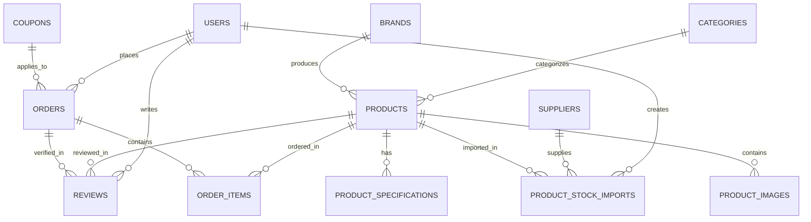

# 08. CƠ SỞ DỮ LIỆU & QUAN HỆ THỰC THỂ (DATABASE SCHEMA)

## 1. Sơ Đồ Thực Thể Quan Hệ (ER Diagram)

---

## 2. Danh Sách Các Bảng Dữ Liệu Chính

### 1. `users`
- Lưu trữ người dùng (Admin và Customer).
- Các trường: `id`, `name`, `email`, `phone`, `address`, `role` (`admin`/`customer`), `password`, `is_active`, `timestamps`.

### 2. `categories` & `brands`
- Quản lý danh mục và thương hiệu của máy tính/thiết bị.
- Các trường: `id`, `name`, `slug`, `description`, `image`/`logo`, `is_active`, `timestamps`.

### 3. `products`
- Bảng trung tâm lưu trữ thông tin sản phẩm và **số lượng tồn kho trực tiếp**.
- Các trường cốt lõi:
  - `price`, `sale_price`, `cost_price`
  - `stock_quantity`: Tồn kho thực tế khả dụng.
  - `min_stock`: Ngưỡng cảnh báo tồn kho thấp.
  - `sold_quantity`: Tổng số lượng đã bán qua các đơn `delivered`.

### 4. `product_specifications` & `product_images`
- Lưu thông số kỹ thuật (`spec_key`, `spec_value`) và danh sách ảnh phụ (`image_path`).
- Ràng buộc: `foreignId('product_id')->constrained()->cascadeOnDelete()`.

### 5. `suppliers`
- Danh mục các nhà phân phối, nhà cung cấp linh kiện.
- Các trường: `id`, `name`, `code`, `contact_name`, `email`, `phone`, `address`, `is_active`, `timestamps`, `deleted_at` (hỗ trợ Soft Delete).

### 6. `product_stock_imports`
- Bảng nhật ký ghi lại các đợt nhập thêm hàng từ nhà cung cấp vào sản phẩm.
- Các trường: `id`, `product_id`, `supplier_id`, `quantity`, `note`, `created_by`, `timestamps`.
- Ràng buộc:
  - `product_id`: `restrictOnDelete()` (chống mất lịch sử).
  - `supplier_id`: `restrictOnDelete()`.
  - `created_by`: `nullOnDelete()`.

### 7. `orders` & `order_items`
- Quản lý thông tin đơn hàng và chi tiết từng món hàng.
- `orders`:
  - `order_code` (unique)
  - `order_status`: `['pending', 'confirmed', 'processing', 'shipping', 'delivered', 'cancelled']`
  - `payment_method`: `['cod', 'banking', 'momo']`
  - `payment_status`: `['unpaid', 'paid', 'refunded']`
  - `subtotal`, `discount_amount`, `shipping_fee`, `total_amount`
  - `inventory_settled` (boolean): Cờ tất toán kho.
  - `restocked_at` (datetime, nullable): Thời điểm hoàn tồn kho thực tế.
  - `cancelled_reason`: Lý do hủy đơn.

### 8. `coupons`
- Quản lý mã giảm giá: `code`, `discount_type`, `discount_value`, `min_order_amount`, `max_discount_amount`, `usage_limit`, `used_count`, `starts_at`, `expires_at`.

### 9. `reviews`
- Nhận xét và chấm điểm sao của khách hàng: `product_id`, `user_id`, `order_id`, `rating` (1-5), `comment`, `status` (`pending`/`approved`/`rejected`).

---

## 3. Các Bảng Kế Thừa Cũ (Bảo Lưu Lịch Sử)
Các bảng `warehouses`, `inventory_stocks`, `stock_receipts`, `stock_receipt_items`, `stock_transactions` được **giữ nguyên trong database** nhằm bảo lưu dữ liệu ban đầu, không bị xóa và không gây ảnh hưởng tới hoạt động của module tồn kho mới.

